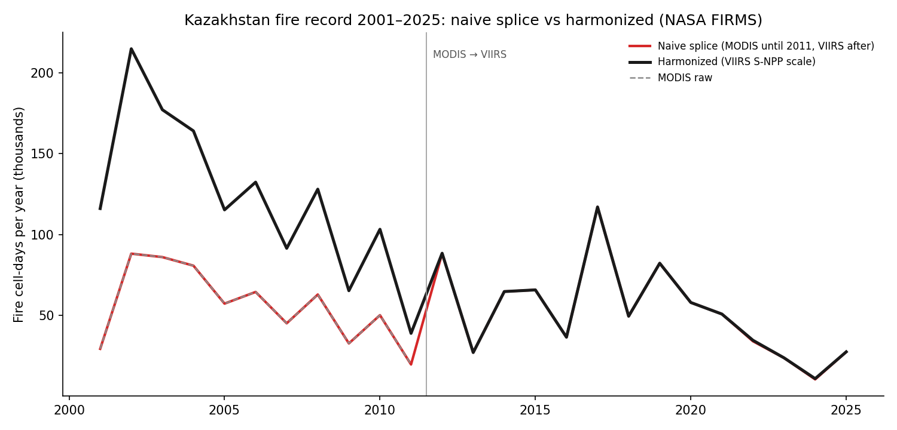

# Dala Fire

**One satellite fire record, 2000 to today: Kazakhstan in depth, the whole world by month.** NASA MODIS and
VIIRS active-fire detections, harmonized onto one scale and served as a burning-activity calendar for any area:
by day for Kazakhstan, by month on a 0.5-degree grid for every country.

Built for the NASA Space Apps Challenge 2026, challenge *Harmonization of MODIS and VIIRS Hot Spots*,
by team Thermal Fusion (Zhoshy Khalelov, Zhangir Abay).

**Live app: https://zhxshy.github.io/dala-fire/**



## Summary

**The problem.** VIIRS (375 m, since 2012) reports about twice as much fire as MODIS (1 km, since 2000) for the
same burning. Joined as they are, Kazakhstan's record jumps 4.5 times from 2011 to 2012. MODIS alone saw 2.3
times. Any trend across 2012 is wrong.

**The method.** Detections become fire cell-days (a 0.01 degree cell with fire on a day). MODIS cell-days are
multiplied by a factor per 3-degree tile, fitted on 3,619 days when Terra, Aqua and Suomi NPP all observed
Kazakhstan and shrunk toward the national factor (2.005) where data are thin. From 2012 the record is VIIRS
itself; NOAA-20 and NOAA-21 fill outages and carry it on after Suomi NPP stopped on 2 November 2026. Satellite
outages are "no data", never zero.

| Result | Value | Limits |
| --- | --- | --- |
| Error of national yearly totals, each year of 2012-2021 left out in turn | 3.0% median (naive splice 50.8%) | Tests years with VIIRS; says nothing direct about 2000-2011 |
| Error per 3-degree tile, same test | 7.6% median, 20.6% at the 90th percentile | Small areas and single months are worse (see the size table on the Methods page) |
| The 2012 jump | harmonized 2.28x, MODIS alone 2.31x, naive 4.53x | Continuity at the switch, not that the factors are right before it; 2012 is also a calibration year, the backcast is the out-of-sample version |
| VIIRS-to-MODIS ratio fitted on each calibration year separately | 1.95 to 2.13 in ten years, while yearly fire differed 4.3 times | Measured in 2012-2021 only |
| Region by region: MODIS x factors against VIIRS, yearly totals 2012-2021 | 16 regions: 2.2% to 7.6% median, all years together within 3% | Fit check, not a blind test. Fails in Mangystau (71%) and Shymkent (65%): rare fire, steady industrial heat that MODIS misses |
| The decline in one sensor alone, nothing rescaled | MODIS 5.0x (2001-2005 to 2021-2025), VIIRS 2.1x (2012-2014 to 2021-2025) | MODIS reads up to 9.5% low after 2021 (orbit drift) |
| Backcast: factors from 2014-2021 predict 2012 and 2013 | +3.2% and -6.3% | Two years only |
| Sensitivity: 12 variants, one choice changed at a time | national error 2.1-3.9%, decline 4.9-5.3x | Variants of one method family, on one country |
| Outage detector against the FIRMS missing-data list | 127 of 178 listed days found independently | Only whole-day, country-wide gaps |

**What it shows.** On one scale, fire activity in Kazakhstan fell 5.4 times from 2001-2005 to 2021-2025; the naive
splice shows 2.3 times and hides more than half of the decline.

**What we cannot claim.** There is no VIIRS before 2012, so the factors assume each tile's VIIRS-to-MODIS ratio
stayed the same; that cannot be measured. No independent ground truth was used. Where fire is rare and comes
from small steady heat sources (Mangystau oil fields, cities), MODIS sees about a third of what VIIRS sees and
values before 2012 are too low; the app says so for any selected area. These are satellite hot spots,
not registered fire incidents: official incident counts follow reporting rules and can move differently. The record shows when and where
burning changed, not why. Single days and weeks before 2012 are less certain than months and years. The
"next 4 weeks" card is a seasonal expectation, not a forecast. Fire power (FRP) is not harmonized.

**Links that open an example:**
[the jump in the naive record](https://zhxshy.github.io/dala-fire/#m=naive) ·
[Kostanay Region, 3 September 2022](https://zhxshy.github.io/dala-fire/#a=KZ-39&d=2022-09-03&top=viirs) ·
[methods and validation](https://zhxshy.github.io/dala-fire/#tab=methods)

## World layer (`scripts/w1_fetch.py`, `scripts/w2_world.py`)

The same method, with nothing retuned, run on the FIRMS yearly files for every country: 548 million detections,
2001-2025, about 200-229 countries a year. Fire cell-days are still counted on 0.01-degree cells; factors are fitted
per 3-degree tile (2,643 tiles), and the record is stored by month on a 0.5-degree grid. The app's World tab
shows it for any country or drawn area, with a map of where it burns.

| Check (each year of 2012-2021 left out in turn) | World | Kazakhstan |
| --- | --- | --- |
| Yearly totals, whole world / whole country | 0.9% median (untreated 63.9%) | 3.0% (untreated 50.8%) |
| One 3-degree tile, one year | 9.0% median, 31.6% at the 90th percentile | 7.6%, 20.6% |
| Backcast of 2012 / 2013 from 2014-2021 | +4.2% / +0.9% | +3.2% / -6.3% |
| 2011 -> 2012: untreated / MODIS alone / harmonized | 2.58x / 1.04x / 1.01x | 4.53x / 2.31x / 2.28x |

By region (9 continental boxes) the median error of yearly totals is 1.0% to 3.8%, with a bias of at most 1.9%
(table: Methods page, or `loyo_by_region.csv`). A factor per tile and calendar month lowered the tile error by
exactly 0.5 points; the rule fixed before the first world run required more than 0.5, so the simpler tile model
is used.

**What it shows.** Joined as they are, the records say the world burns 2.3 times more in 2021-2025 than in
2003-2007. On one scale it burns about 14% less. VIIRS alone, which needs no harmonizing, also shows slightly less
fire in 2021-2025 than in 2012-2014. The direction agrees with the published decline in global burned area
(Andela et al. 2017, Science 356: 1356). Run independently at 0.5 degrees with global factors and Natural Earth
borders, Kazakhstan comes out 5.4 times lower in 2021-2025 than in 2001-2005, the same as the detailed
national pipeline.

**Limits.** A tenth of tiles err by more than 30% in a single year: they have little fire. Regional satellite
outages are not detected, only worldwide ones. Months, not days. The record ends with 2025 (standard data only).

## Data

NASA FIRMS Archive Download, country = Kazakhstan, 2000-11-01 to 2026-11-13, CSV:

| File | Product | Period |
| --- | --- | --- |
| `DL_FIRE_M-C61_*.zip` | MODIS Collection 6.1 (Terra, Aqua), 1 km | 2000-11 onward |
| `DL_FIRE_SV-C2_*.zip` | VIIRS S-NPP Collection 2, 375 m | 2012-01 to 2026-11-02 |
| `DL_FIRE_J1V-C2_*.zip` | VIIRS NOAA-20 Collection 2, 375 m | 2018-04 onward |
| `DL_FIRE_J2V-C2_*.zip` | VIIRS NOAA-21 Collection 2, 375 m | 2023-03 onward |

Each zip holds a science-quality archive file and a near-real-time file for the most recent months.
Raw data is not stored in git. Put the four zip files in `data/raw/`.

Region boundaries: OpenStreetMap, `boundary=administrative`, `admin_level=4` inside Kazakhstan
(17 regions incl. Abay, Jetisu and Ulytau, plus Astana, Almaty and Shymkent), exported with Overpass
Turbo as GeoJSON. Save it as `data/raw/boundaries/osm_kz_admin4.geojson`. © OpenStreetMap contributors, ODbL.

## Run

```
pip install -r requirements.txt   # includes shapely for step 6
python run_all.py
```

| Step | Script | Output in `data/interim/` |
| --- | --- | --- |
| 1 | `scripts/01_ingest.py` | `hotspots_all.parquet`: every detection, one schema, archive + NRT without overlap |
| 2 | `scripts/02_grid.py` | `hotspots_clean.parquet`, `celldays.parquet`, `static_mask_cells.parquet` |
| 3 | `scripts/03_availability.py` | `sensor_availability.parquet`, `sensor_gaps.csv` |
| 4 | `scripts/04_harmonize.py` | `harmonized_celldays.parquet`, `day_source.parquet`, `strata.json`, `national_monthly_harmonized.csv` |
| 5 | `scripts/05_validate.py` | `validation.json`, `error_by_count.csv`, `figures/02_before_after.png` |
| 6 | `scripts/06_export_web.py` | `web/public/data/`: files the web app loads (about 45 MB, committed to git) |

### Automatic updates (`scripts/09_update.py`, `.github/workflows/update.yml`)

Every 3 hours a GitHub Actions job asks the FIRMS area API for near-real-time detections (MODIS, NOAA-20, NOAA-21),
applies the same cleaning, mask, grid and factors to them, adds each UTC day once it is complete, commits the
data and redeploys the site. The last two published days are fetched again, because near-real-time data keeps
arriving. Run against the pipeline's own input for the same days, the updater reproduces the pipeline's output
exactly (1,836,281 cell-day rows, no difference). It refuses to write if the API returns an error page, no rows
at all, or implausible counts.

The FIRMS MAP_KEY is stored only as the repository secret `FIRMS_MAP_KEY`. It is not in the code, the logs or the
site, and the browser never calls the FIRMS API. Without the secret the job does nothing. A full rerun of
`run_all.py` replaces the updater's days with whatever the raw download holds; the next scheduled run adds
them back.

Numbers to expect with the download above:

| Check | Value |
| --- | --- |
| Detections loaded | 4,152,447 |
| Detections kept after cleaning | 3,200,835 (77.1%) |
| Fire cell-days | 2,268,202 |
| Gap days found: Terra / Aqua / S-NPP / NOAA-20 / NOAA-21 | 63 / 33 / 53 / 6 / 2 |
| MODIS -> S-NPP national factor | 2.005 (3,619 calibration days) |
| Harmonized total, all years | 2,118,602 cell-days |

## Web app

`web/` is a static React + MapLibre site. It loads `web/public/data/` and computes every chart in the
browser, so it needs no server and no API key.

```
cd web
npm install
npm run dev            # http://localhost:5173/dala-fire/
```

Every push to `main` builds the site and publishes it on GitHub Pages
(`.github/workflows/deploy.yml`). One-time setup: Settings -> Pages -> Source: GitHub Actions.
Before building, the workflow type-checks the code and runs `npm run check`, which fails if a headline
number in this README no longer matches `web/public/data/model.json`.

"Unusual" is judged against the last 10 years by default, because fire fell about five times after the
2000s and against 2001 onward almost every recent month looks low. One switch ("Compare with") changes
the reference to all years since 2001 for the cards, the regions list, the fire season and the anomaly
calendar. Dates are UTC days, as in the FIRMS files.

## Method

- **Cleaning.** MODIS confidence >= 30; VIIRS nominal or high; FIRMS type 0 (vegetation fire) where
  the type is known; a static-source mask (cells with repeated type 2/3 detections, plus neighbours)
  applied to all rows, including near-real-time rows that carry no type.
- **Fire cell-day.** A 0.01 degree cell with at least one clean detection from a sensor on a day.
  Many 375 m VIIRS pixels from one fire fall into one cell, which removes most of the pixel-size
  difference from 1 km MODIS.
- **Sensor gaps.** Days on which a satellite delivered nothing are inferred from the detections
  (see the docstring of `03_availability.py`) and are treated as "no data", not as zero. They are
  cross-checked with a snapshot of the FIRMS API `missing_data` table
  (`scripts/ref/firms_missing_dates.csv`, retrieved 2026-11-14): of its 178 listed days, 127 were
  already flagged by our rules, 13 (winter days with no detections) were added, and 38 were kept
  because the archive holds complete data for them (S-NPP, May 2026: S-NPP/NOAA-20 = 0.99; NOAA-21
  near-real-time entries for Feb-Mar 2024, which our standard-product archive covers). Validation
  numbers did not change. Per-day outcomes: `data/interim/firms_crosscheck.csv`.

- **Harmonization.** Everything is put on the VIIRS S-NPP scale. MODIS (Terra or Aqua) counts are
  multiplied by a factor per 3-degree tile, fitted on 2012-2021 days when Terra, Aqua and S-NPP all
  delivered data and shrunk toward the national factor (2.005) where data is thin. Terra-only and
  Aqua-only days use a bridge factor fitted on 2003-2011. Days without S-NPP use NOAA-20 (x0.998) or
  NOAA-21 (x1.035). The model is a sum over cells, so any area's value is exact in the browser.

## Validation (leave-one-year-out, 2012-2021)

| Model | Country, median error | Country, max error | 3-degree tile, median error |
| --- | --- | --- | --- |
| Naive splice (no correction) | 50.8% | 53.0% | 51.1% |
| One national factor | 2.9% | 6.3% | 10.6% |
| Tile factors, shrinkage 200 (used) | 3.0% | 7.0% | 7.6% |
| Tile x season factors | 3.2% | 7.1% | 7.6% |

Other checks: backcast of 2012 / 2013 from a model fitted on 2014-2021: +3.2% / -6.3%. Drift years
2022-2025 (fitted on 2012-2021): +3.0% to -9.5%, so MODIS after 2021 is used only on days without VIIRS.
At the 2011 -> 2012 seam the naive splice jumps 4.53x, MODIS alone 2.31x, the harmonized record 2.28x.

Limits: the model cannot create fire where MODIS saw none. In 0.25-degree cells by month, 8.3% of
VIIRS activity falls where MODIS saw nothing (2.1% at 1 degree), so small areas are marked indicative.
`error_by_count.csv` gives the observed/predicted spread by the size of the prediction; the app uses it
as the uncertainty band.

## Sensitivity (`scripts/07_sensitivity.py`)

Each row changes one choice and reruns everything that depends on it. "Decline check" is harmonized
MODIS 2003-2005 against S-NPP 2021-2025 (mean national cell-days per year), a quick check of the
headline trend; a naive splice gives about 2.3x.

| Variant (one change from the baseline) | MODIS factor | Country, median error | 3-degree tile, median | Tile, 90th pct | Backcast 2012 / 2013 | Decline check |
| --- | --- | --- | --- | --- | --- | --- |
| Baseline | 2.00 | 3.0% | 7.6% | 20.6% | +3.2% / -6.3% | 5.21x |
| No confidence filter | 2.04 | 3.1% | 7.1% | 19.5% | +1.4% / -5.4% | 5.25x |
| Stricter MODIS confidence (>= 50) | 2.31 | 3.8% | 8.6% | 21.5% | +4.7% / -8.3% | 5.17x |
| Static mask without dilation | 2.02 | 3.1% | 7.9% | 21.9% | +2.8% / -6.6% | 5.08x |
| No static mask | 2.08 | 3.9% | 8.8% | 25.5% | +2.2% / -8.2% | 4.88x |
| Cell size 0.005 deg | 2.75 | 2.1% | 8.6% | 23.3% | +3.3% / -0.5% | 5.23x |
| Cell size 0.02 deg | 1.70 | 3.8% | 6.5% | 19.3% | +3.1% / -8.3% | 5.11x |
| Tiles 2 deg | 2.00 | 3.4% | 9.1% | 25.2% | +3.2% / -6.6% | 5.23x |
| Tiles 5 deg | 2.00 | 3.3% | 7.1% | 20.5% | +3.7% / -4.9% | 5.18x |
| Shrinkage 0 | 2.00 | 3.1% | 7.6% | 20.4% | +3.3% / -6.3% | 5.22x |
| Shrinkage 50 | 2.00 | 3.0% | 7.6% | 20.5% | +3.3% / -6.3% | 5.21x |
| Shrinkage 1000 | 2.00 | 3.0% | 7.8% | 20.4% | +3.0% / -6.1% | 5.19x |
| Separate day and night factors | 2.00 | 3.6% | 8.7% | 22.6% | -0.0% / -10.8% | 5.04x |

Across all 12 variants the country error stays between 2.1% and 3.9% (naive splice: 50.8%) and the
decline between 4.9x and 5.3x. The factor itself moves with the cell size (1.70 at 0.02 degrees, 2.76
at 0.005 degrees) because it converts between definitions, but the accuracy does not depend on it.
Shrinkage hardly matters (tiles are data-rich); it is kept as a guard for thin tiles. The static mask
matters most: without it the tile error rises to 8.8% (90th percentile 25.5%) because gas flares in
the west inflate both sensors differently. Separate factors for day-only and night cell-days (as some
harmonizations do) make every measure worse here (country 3.6%, tile 8.7%, 2013 backcast -10.8%), so
day and night share one factor. No variant is better on every measure, so the baseline was not tuned to
the test.

`explore/` holds quick looks (national series, the 2012 seam figure). They are not part of the pipeline.

## Design questions

Raised by participants in the challenge discussion
([nasa/spaceapps #1879](https://github.com/nasa/spaceapps/discussions/1879); the replies there are not official):

- **MODIS or VIIRS scale?** VIIRS (Suomi NPP): the scale of today's and future data, so the record continues unchanged on
  NOAA-20/21 after MODIS ends. Cost: pre-2012 values are modelled from MODIS; they are flagged, carry a band, and cannot
  show small fires MODIS never saw.
- **FIRMS archive or swath?** FIRMS Archive Download (standard data; NRT only after the last standard date). Cloud cover
  and view angle are not modelled.
- **Continuity after Suomi NPP?** Built in: its last day in the data is 2026-11-02; NOAA-20 (x0.998) and NOAA-21 (x1.035)
  are tied to it on shared days and fly the same afternoon orbit.
- **Users and time step?** Stored per day; shown by month (calendar), week (fire season, critical periods) and day
  (biggest fire days).
- **Earth Engine?** Not used; everything comes from FIRMS files and open scripts.

## Use of AI

AI tools (Claude) were used for research, planning and drafting code. Each AI-drafted script says so
in its docstring. Method choices and checks are the author's.

## Data citation

We acknowledge the use of data and imagery from LANCE FIRMS, operated by NASA's Earth Science Data
and Information System (ESDIS), with funding provided by NASA Headquarters
(https://firms.modaps.eosdis.nasa.gov).

- MODIS Collection 6.1 active fire, standard (MCD14ML): https://doi.org/10.5067/FIRMS/MODIS/MCD14ML
- MODIS Collection 6.1 active fire, near real time (MCD14DL): https://doi.org/10.5067/FIRMS/MODIS/MCD14DL.NRT.0061
- VIIRS 375 m, Suomi NPP: standard https://doi.org/10.5067/VIIRS/VNP14IMG.002, NRT https://doi.org/10.5067/FIRMS/VIIRS/VNP14IMGT_NRT.002
- VIIRS 375 m, NOAA-20: standard https://doi.org/10.5067/VIIRS/VJ114IMG.002, NRT https://doi.org/10.5067/FIRMS/VIIRS/VJ114IMGT_NRT.002
- VIIRS 375 m, NOAA-21: standard https://doi.org/10.5067/VIIRS/VJ214IMG.002, NRT https://doi.org/10.5067/VIIRS/VJ214IMG_NRT.002

Algorithms: Giglio, Schroeder & Justice (2016), Remote Sensing of Environment 178, 31-41,
https://doi.org/10.1016/j.rse.2016.02.054; Schroeder et al. (2014), Remote Sensing of Environment 143,
85-96, https://doi.org/10.1016/j.rse.2013.12.008.

Region boundaries: © OpenStreetMap contributors, ODbL.
